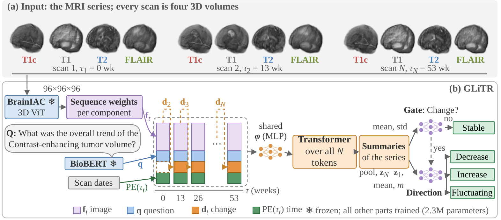

# GLiTR: Glioma Temporal Transformer

A lightweight model that answers questions about tumor change from the **whole MRI series** of a glioma patient, with **no tumor
segmentation as input**.

## Overview

After treatment, glioma patients receive MRI scans every few months. Given all scans of a patient and a question about one tumor
component (necrosis, enhancing tumor, edema), GLiTR answers whether the component **decreased, stayed stable, increased or fluctuated**
over the series (trend question), or how it changed from the first to the last scan (net-change question).

### Key Features

- **Whole series at real scan times**: every scan of a patient is read, placed at its acquisition time; one scan pair cannot show a
  component that rises and then falls.
- **No tumor segmentation as input**: crops are centered on the skull-stripped brain; no mask is read at training or inference.
- **Small trained part**: frozen BrainIAC (brain MRI) and BioBERT (text) encoders; only 2.3M parameters are trained.
- **Adjustable labels**: the labels come from one threshold pair per component (`glitr/labels.py`); set your own thresholds, rebuild the
  labels and retrain.

## Architecture

<p align="center"></p>

Frozen encoders turn each scan (four sequences: T1c, T1, T2, FLAIR) and the question into features. Learned weights for the asked
component combine the four sequence features. Each scan becomes one token with its features, their change since the previous scan
and the scan time. A small transformer relates the tokens of the whole series, and a cascade head first decides Stable or Change,
then the direction.

## Installation

```bash
git clone https://github.com/harsh-c-16/GLiTR-Longitudinal-VQA-on-Glioma-MRI.git
cd GLiTR-Longitudinal-VQA-on-Glioma-MRI
conda create -n glitr python=3.10
conda activate glitr
pip install -r requirements.txt
```

Frozen weights: download `BrainIAC.ckpt` from its authors ([BrainIAC](https://github.com/AIM-KannLab/BrainIAC)); it is licensed for
non-commercial academic research only and is not included here. BioBERT (`dmis-lab/biobert-v1.1`) is downloaded from Hugging Face on first use.

## Hardware Requirements

- **GPU**: one NVIDIA GPU with CUDA 12 (the pinned `torch==2.5.1` wheel ships CUDA 12.4). We used RTX A6000 (48 GB) and
  RTX A5000 (24 GB) for MU-Glioma-Post and L40S (48 GB) for LUMIERE. Training reads the precomputed features, and one job needs
  about 1 GB of GPU memory, so several seeds can share a card (`JOBS` in `scripts/run_seeds.sh`).
- **Disk**: the frozen features take under 10 MB per cohort; the raw MRI datasets are downloaded separately.
- **Software**: Linux, Python 3.10.

## Dataset Preparation

Download both datasets yourself:

- **LUMIERE** (Suter et al., 2022): images in `Lumiere_dataset/Imaging/<Patient-xxx>/<week-...>/HD-GLIO-AUTO-segmentation/registered/{CT1,T1,T2,FLAIR}_r2s_bet_reg.nii.gz`,
  plus `LUMIERE_data.csv` for step 1 of Usage: the per-visit DeepBraTumIA voxel counts (columns Patient, Timepoint, Label,
  NumberOfVoxels). It is not part of the LUMIERE download; build it from the per-visit `measured_volumes_in_mm3.json` files, which
  match it at almost every visit, so a rebuilt table can change a few labels (the shipped `configs/gt_lumiere.csv` is the
  reference). It names labels 1 and 2 the wrong way round (1 is the enhancing core, 2 the necrotic core); `glitr/labels.py`
  follows the image content.
- **MU-Glioma-Post** (TCIA, 2025): `MU-Glioma-Post/PatientID_xxxx/Timepoint_n/*_brain_{t1c,t1n,t2w,t2f}.nii.gz`.

A scan is used only if its segmentation file exists, because its label comes from it; the segmentation itself is never read by the model.
The labels, patient folds and MU scan days we used are in `configs/`; they are derived from the two datasets and shared under
the same CC BY 4.0 license.

## Usage

```bash
# 1. Labels (already in configs/; rebuild them, e.g. after changing the thresholds in glitr/labels.py)
python -m glitr.labels lumiere --volumes LUMIERE_data.csv --out configs/gt_lumiere.csv
python -m glitr.labels mu --root MU-Glioma-Post --out configs/gt_mu.csv

# 2. Frozen features from raw MRI (GPU recommended)
python -m glitr.preprocess lumiere --root Lumiere_dataset/Imaging --brainiac BrainIAC.ckpt --out feats/lumiere
python -m glitr.preprocess mu --root MU-Glioma-Post --days configs/mu_timepoint_days.csv --brainiac BrainIAC.ckpt --out feats/mu

# 3. Training and evaluation: 5 seeds, nested checkpoint selection, the tuned hyperparameters in configs/hp.json
bash scripts/run_seeds.sh lumiere feats/lumiere runs

# 4. Input ablations (same hyperparameters as the full model)
NAME=no_images ARGS="--ablation no_images" bash scripts/run_seeds.sh lumiere feats/lumiere runs
NAME=no_order  ARGS="--ablation no_order"  bash scripts/run_seeds.sh lumiere feats/lumiere runs

# 5. Results: mean +- SD over seeds, and each ablation vs the full model with paired patient-bootstrap intervals
python scripts/summarize.py runs
python scripts/bootstrap.py runs --out runs/report

# 6. Optional: re-tune (30 Optuna trials per outer fold, inside that fold's training patients) into a new file, then train with it
bash scripts/tune_hp.sh lumiere feats/lumiere configs/hp_retuned.json
HP_FILE=configs/hp_retuned.json bash scripts/run_seeds.sh lumiere feats/lumiere runs_retuned
```

Replace `lumiere` by `mu` for the second cohort. `--ablation no_images` zeroes every image feature (question, scan count and times
remain); `--ablation no_order` shuffles the scans of a series and zeroes the times. Training needs per-fold hyperparameters
(`--hp`, `--hp-file` with `--cohort`, or `--tune-trials`).

Seeds fix initialization, sampling and the inner split, so reruns on the same GPU type give the same predictions; on another GPU
type, one seed's HM-F1 can move by a few hundredths. This is research code, not a clinical tool.

## Repository Structure

```
GLiTR-Longitudinal-VQA-on-Glioma-MRI/
├── glitr/
│   ├── preprocess.py      # 1  model
│   ├── data.py            # 2  model
│   ├── model.py           # 3  model (architecture)
│   ├── train.py           # 4  model
│   ├── evaluate.py        # 5  model
│   └── labels.py          # 6  supplementary
├── scripts/
│   ├── run_seeds.sh       # 7  supplementary
│   ├── tune_hp.sh         # 8  supplementary
│   ├── summarize.py       # 9  supplementary
│   └── bootstrap.py       # 10 supplementary
├── configs/               # data and settings
├── assets/model.png
├── requirements.txt
└── LICENSE
```

## Acknowledgments

- [BrainIAC](https://github.com/AIM-KannLab/BrainIAC) brain-MRI foundation model (Tak et al., 2026)
- [BioBERT](https://huggingface.co/dmis-lab/biobert-v1.1) biomedical language model (Lee et al., 2020)
- [LUMIERE](https://doi.org/10.6084/m9.figshare.c.5904905.v1) dataset (Suter et al., 2022)
- [MU-Glioma-Post](https://doi.org/10.7937/7K9K-3C83) dataset, The Cancer Imaging Archive (Yaseen et al., 2025)
- [MONAI](https://monai.io), [Hugging Face Transformers](https://github.com/huggingface/transformers) and [Optuna](https://optuna.org) libraries
